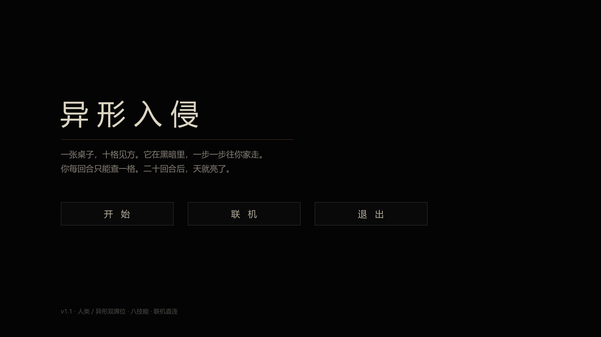
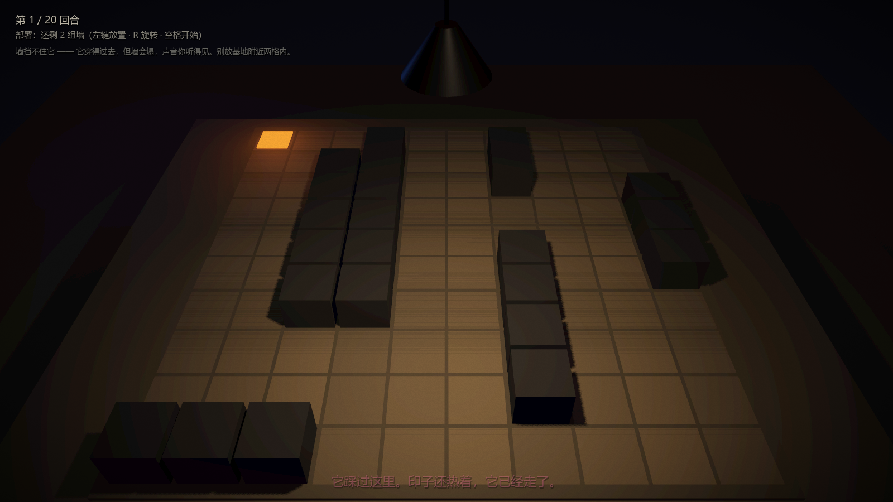
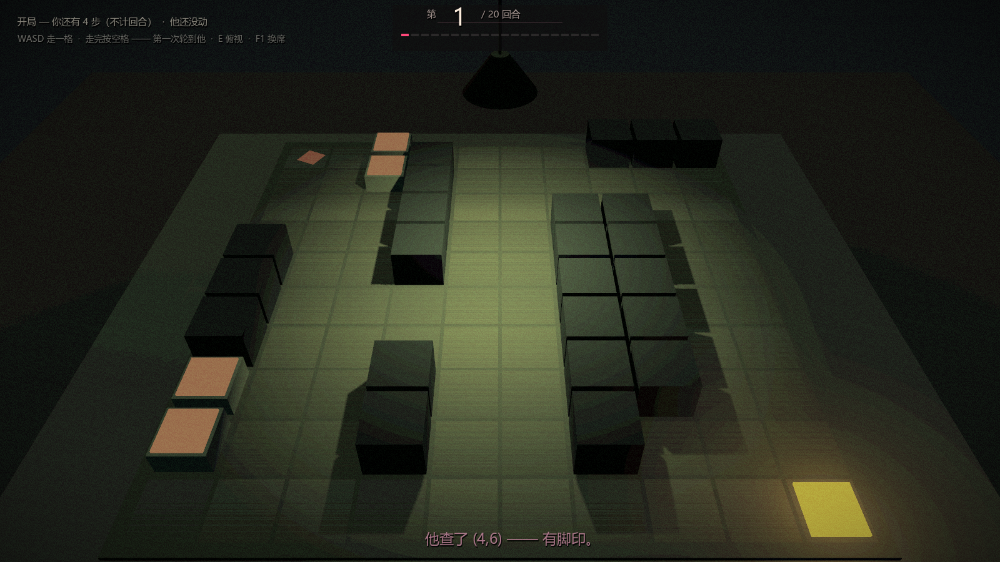
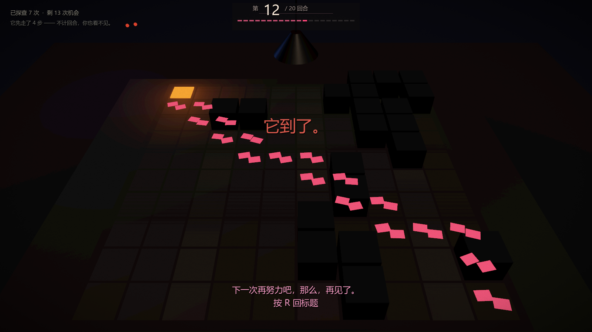

# 异形入侵 · Alien Invasion 3D

> 一张桌子，十格见方。它在黑暗里，一步一步往你家走。
> 你每回合只能查一格。二十回合后，天就亮了。

一个 1v1 回合制的**信息博弈**游戏：一边是坐在值班室里盯着沙盘的人类，一边是黑暗里朝 (0,0) 潜行的异形。人类看不见异形，只能靠"探查一格"换回一点关于**过去**的情报；异形看得见人类查了哪一格，但不知道人类的技能是什么。

引擎：**Godot 4.7**（`config/features = 4.7`），全部场景与美术由代码程序化生成，无外部美术资源。





## 玩法

| 项 | 规则 |
|---|---|
| 棋盘 | 10×10，山地随机生成，每局都不一样 |
| 人类位置 | 固定在 (0,0)，不能移动 |
| 异形位置 | 从 (9,9) 出发，开局白走 **4 步**（不计回合，人类看不见） |
| 时限 | **20 回合**。第 21 回合天亮，人类胜 |
| 人类每回合 | 1 次行动：探查一格 / 引爆地雷 / 投掷道具 |
| 探查结果 | `0` 没痕迹 · `1` 走过但已离开 · `2` 它就在这儿（命中） |
| 足迹寿命 | 人类视角的足迹按回合消退（第 1 回合看到的第 10 回合消失）；异形视角永久 |
| 异形胜利 | 走到 (0,0) |
| 人类胜利 | 查中（打死）/ 地雷或投掷物打死 / 撑过 20 回合 |

设计上最核心的一条：**情报永远是过去时**。你查到的是它刚才在哪，而不是它现在在哪——所以 20 次探查永远不够覆盖 100 格，只能靠推理。

## 技能（暗选，每人一个）

**人类**

| 技能 | 效果 |
|---|---|
| 布障者 | 部署阶段盲放 2 组墙（每组 2 格）。它穿得过去，但会把墙撞碎，那一声你听得见，方位也听得出来 |
| 地雷师 | 部署 3 颗雷，每颗覆盖 3×3。引爆消耗你这一回合的行动；命中 1 点伤害，未命中永久失效 |
| 投掷者 | 闪光弹 / 手雷 / 燃烧弹各一颗。扔出去那回合不能再探查 |
| 求生者 | 第 7 回合起每回合能连查 2 格，第 15 回合起 3 格 |

**异形**

| 技能 | 效果 |
|---|---|
| 强健体魄 | 两条命。被查中一次不会死，但下一回合它会跑起来（3 步） |
| 爆发力 | 一回合 3 步，下一回合动不了 |
| 弹跳力 | 整局可跃过一格 2 次，跳过的那格不留痕迹 |
| 捕食本能 | 第 7 回合起每回合走 2 步，第 15 回合起 3 步 |


## 操作

| 操作 | 人类席 | 异形席 |
|---|---|---|
| 左键 | 探查一格 / 放置道具 | 走一格（也可以点远格自动寻路） |
| WASD | — | 走一格（按屏幕方向） |
| Shift + WASD | — | 跃过一格（弹跳力） |
| 1 / 2 / 3 · Esc | 拿起/放下 闪光弹 / 手雷 / 燃烧弹 | — |
| 空格 | 结束部署 / 结束回合 | 结束回合 |
| R | 放置时旋转墙体 | — |
| E | 俯视 / 回正视角 | 同 |
| 按住右键 | 转头 | 同 |
| F1 | 单机练习：换到对面座位 | 同 |
| M | 静音 / 恢复 | 同 |

## 联机

不需要额外服务器 —— **房主的游戏进程自己监听 7788**，客机直连。

1. 双方都点「联机」
2. 一个人点「开房」，得到一个 **4 位房间号**，告诉对面
3. 另一个人填号码点「加入」（同一局域网 / 虚拟局域网即可；房间号靠 UDP 广播 7789 自动找地址）
4. 房主选阵营 → 双方各自暗选技能 → 房主开局

跨网段（或对方不在同一虚拟局域网）时，勾上「走中转服务器」，并另起 `server/` 里的 relay：

```powershell
cd server
npm install
node relay.mjs        # 默认 7788，也可 node relay.mjs 9000
```

规则只在**房主**那一端跑（房主权威），服务器只转发消息。

## 运行

1. 装 **Godot 4.7**（标准版即可，不需要 .NET）
2. 导入 `project.godot`，按 F5

导出用的 exe 不放在仓库里，走 Releases。

## 目录

```
menu.gd / menu.tscn      标题 → 选阵营 → 选技能 → 联机页
main.gd / main.tscn      对局：棋盘、回合、技能、HUD、音效
config.gd                双方的静态配置（阵营、技能、地图种子、联机模式）
net.gd                   联机层（房主监听 / 客机直连 / UDP 房间号发现）
texts.gd + texts.txt     所有台词。texts.txt 是覆盖层，改那一份就行，不用动代码
fx_overlay.gdshader      全屏后期：暗角、颗粒、血腥、夜视
audio/                   合成的房间底噪（84 秒无缝循环）与生成脚本
sfx/                     探查、命中、脚步、心跳
server/                  可选的中转服务器 + 几个测试用假客户端
docs/                    截图
```

## 台词

所有文字都在 `texts.txt` 里，一行一条：

```
res_trail = 有痕迹 —— 它曾经在这里。现在不在。
lose_arrive_title = 它到了。
```

`#` 开头是注释。改完直接跑，不用重新编译。代码里的默认值在 `texts.gd`，`texts.txt` 只写你想覆盖的那几条。

## 已知未做

- 地雷/投掷物的爆炸特效还是占位（只有一层白光和一片焦痕）
- 没有 AI 难度分级，脚本对手只有一种性格
- 音效素材是早期占位，脚步与心跳还没做方位感

## 素材与许可

- 代码、场景、shader：本仓库
- 音频：`audio/make_bgm.py` 现场合成；`sfx/` 是早期占位素材
- 美术：没有外部素材，全部几何体 + 材质程序化生成



